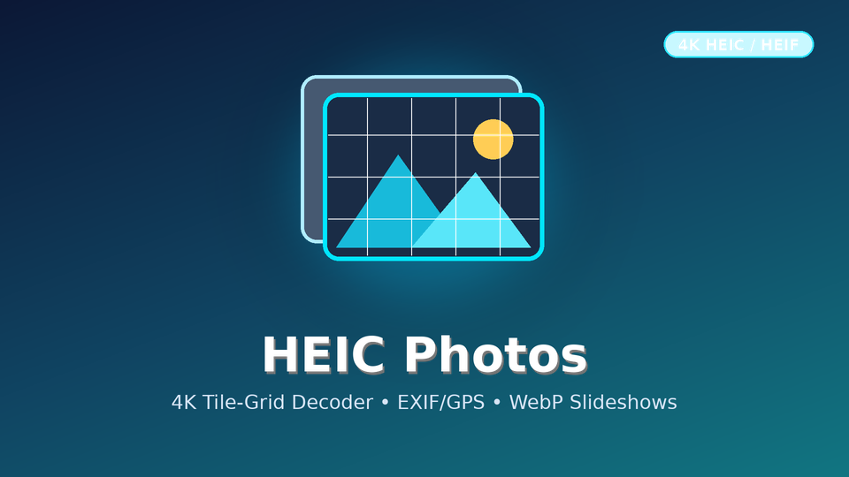

# HEIC Photos (Jellyfin.Plugin.HeicPhotos)



Indexes HEIC/HEIF photos, reads EXIF/GPS metadata, decodes tiled iPhone/Android HEICs via FFmpeg 8, and transcodes fullscreen slideshows to 4K WebP.

## Installation via Jellyfin Plugin Repository

Add the following repository URL in **Dashboard -> Plugins -> Repositories**:

```
https://raw.githubusercontent.com/koopjm/jellyfin-plugins/main/manifest.json
```
